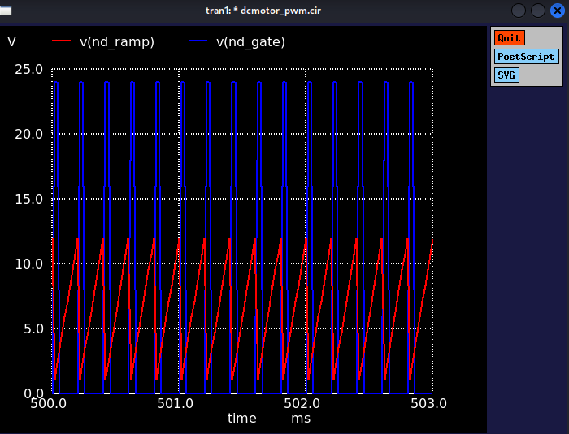

# PMDC Motor Speed Control with a PI Controller in ngspice

State-space averaged model of a permanent magnet DC motor with a PI speed
controller, simulated in ngspice.

## Overview

The project simulates closed-loop speed control of a PMDC motor with a PI
controller. The motor dynamics are written as a state-space system directly in
ngspice, using B-sources and capacitors as state variables, so the model has
no switching and no algebraic loops.

## Model

The model has three state variables, each stored as the voltage across a capacitor.

- `V(nd_ia)` = armature current [A]
- `V(nd_omega)` = angular velocity [rad/s]
- `V(nd_intg)` = PI integrator state [V]

The differential equations are listed below.

```
La * dIa/dt    = Va - Ra*Ia - Ke*omega
J  * dOmega/dt = Kt*Ia - Bm*omega
dIntg/dt       = Ki * (omega_ref - omega)
Va = clamp(Kp*err + Intg, 0, Vbus)
```

## Motor Parameters

| Parameter | Value | Unit |
|-----------|-------|------|
| Ra | 0.5 | Ω |
| La | 2 | mH |
| Ke = Kt | 0.02 | V·s/rad |
| J | 1e-4 | kg·m² |
| Bm | 1e-4 | N·m·s/rad |

## Steady State (analytical)

| Quantity | Value |
|----------|-------|
| Target speed ω | 314 rad/s (~3000 rpm) |
| Ia_ss | 1.57 A |
| Va_ss | 7.07 V |
| Duty cycle | 29.4% |

## Results

With PI gains Kp = 0.05 and Ki = 0.5, the step response settles to 314 rad/s
with minor overshoot. The PWM visualization at 5 kHz uses a sawtooth ramp
built with floor(), and its gate comparator confirms a duty of 29.4% at steady
state.

### Step Response


### PWM Visualization (steady-state, zoomed)


## Why State-Space in ngspice?

Cycle-by-cycle PWM simulation in ngspice runs into severe numerical stiffness
because of three conflicting time scales (tau_e = 4ms, tau_m = 1s,
T_pwm = 200µs). The averaged state-space approach removes the switching
transients while keeping the control dynamics, which is standard practice in
control system design.

The PWM visualization is a separate observation layer (Bramp, Bgate). It reads
nd_va but does not feed back into the motor dynamics, much like probing a
circuit without disturbing it.

## Files

| File | Content |
|------|---------|
| `dcmotor_minimal.cir` | Core PI and state-space model |
| `dcmotor_pwm.cir` | Adds the PWM visualization layer (5kHz sawtooth comparator) |
| `archive/` | Earlier development iterations, kept for reference (see below) |

## Development History

The final model came out of a series of attempts, kept in `archive/`. The
first versions simulated the switching converter cycle by cycle, and the
stiffness problem described above is what pushed the design toward the
averaged state-space model.

| File | Approach |
|------|----------|
| `dcmotor_pid.cir` | First switching PWM model (voltage-controlled switch + ramp reset) |
| `dcmotor_pid2.cir` | Back-calculation anti-windup and steady-state `.measure` checks |
| `dcmotor_pid3.cir` | Current sensing fix, freewheel diode, PWM reset pulse, solver options |
| `dcmotor_pid4.cir` – `dcmotor_pid6.cir` | Analytical checks of steady state, ramp amplitude, diode and sensor polarity |
| `dcmotor_pid_final.cir` | Last switching version (back-EMF sign and freewheel direction fixed) |
| `dcmotor_averaged.cir` | Switch removed, PI output drives the motor as average voltage |
| `dcmotor_statespace.cir` | Ia and omega as capacitor states, no algebraic loops |
| `dcmotor_pwm_vis.cir` | First version of the PWM observation layer |

The archived netlists are kept as they were, with only their comments
translated to English. They are not maintained.

## Tools

ngspice 40+
